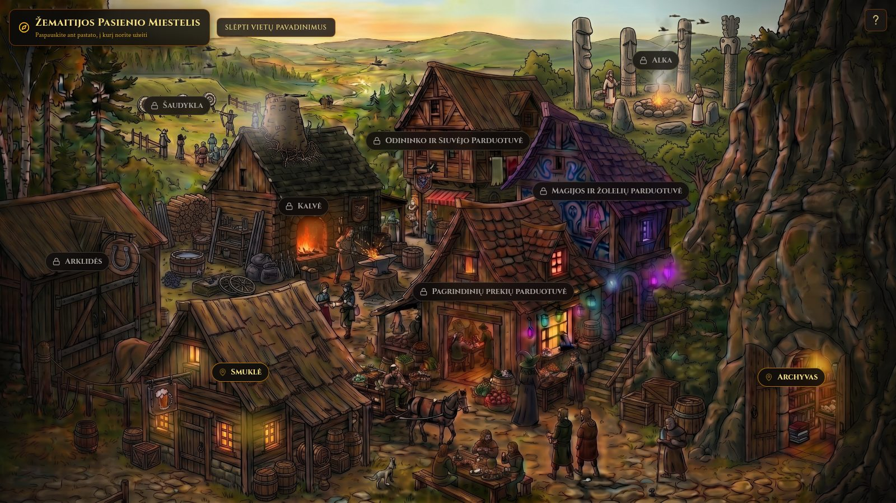
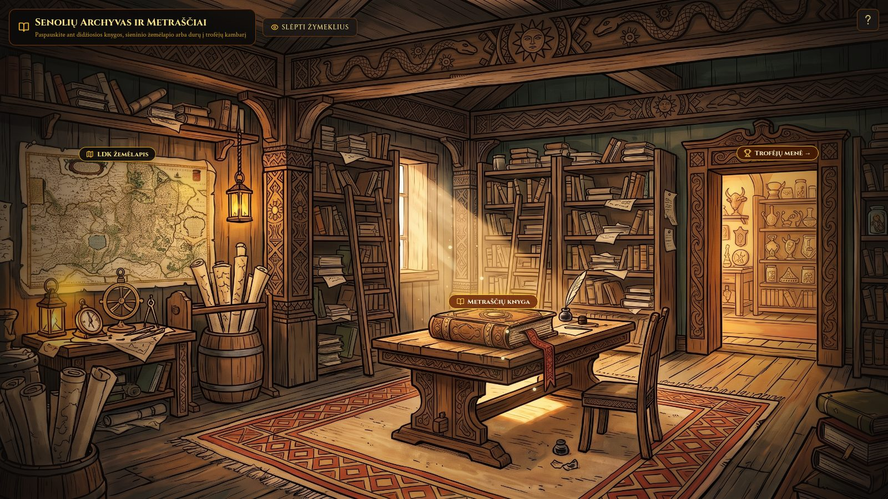
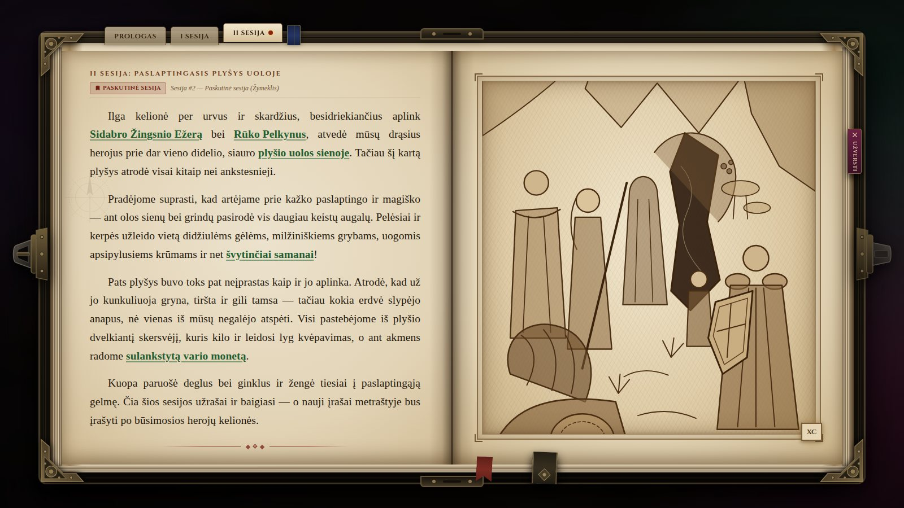
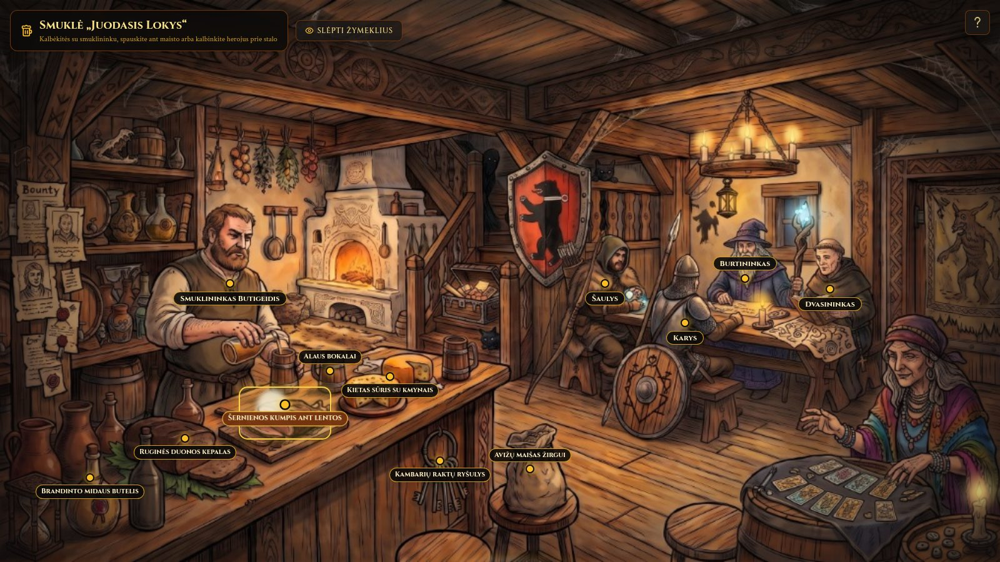
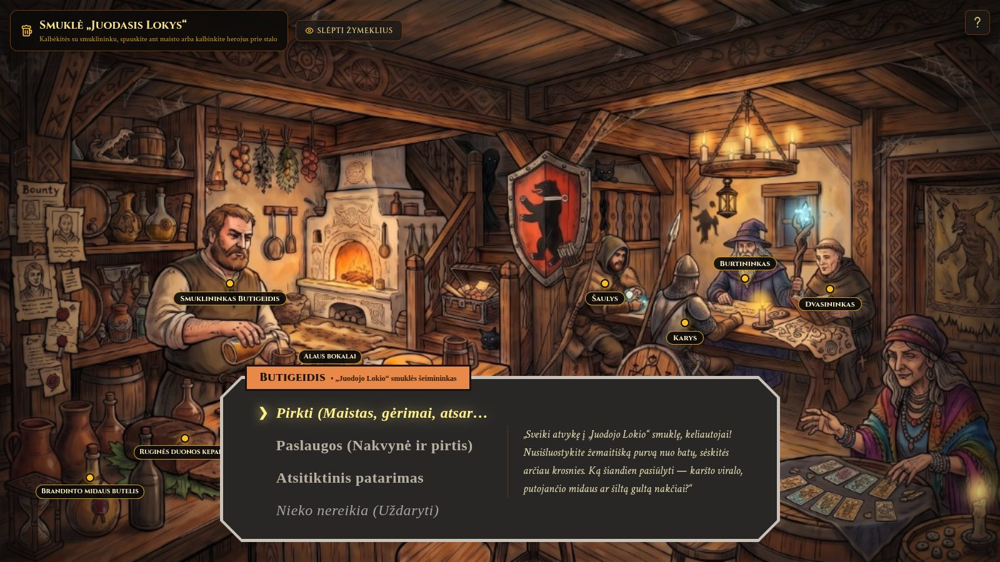

# Žemaitijos Miestelis

An interactive D&D 5e companion for a 15th-century Samogitian border town in the Grand Duchy of Lithuania (LDK). Walk the painted town, step into the tavern and the archive, and read the campaign chronicle. The interface is in Lithuanian.

## Features

### Town

The opening scene is **Žemaitijos Pasienio Miestelis**, a painted square you can walk.

- Every building is a hotspot with a nameplate. Nameplates can be hidden.
- Hovering a building shows its name, whether it is open, where it sits in the square, and a short description.
- Entering an open building plays a short footstep path, then changes the scene. The browser Back button returns to the square.
- **Smuklė** and **Archyvas** are open. The smithy, magic and herb shop, leatherworker and tailor, archery range, stables, general store, and sacred *alka* are still locked; choosing one explains when that place will open.

### Tavern

**Smuklė „Juodasis Lokys“** is the inn.

- Talk to the innkeeper, **Butigeidis**. He sells food and drink, offers lodging and a bath, or gives a random tip about something on the menu.
- Goods on the counter and shelves can be selected directly.
- Four adventurers sit at the table — **Šaulys**, **Karys**, **Burtininkas**, and **Dvasininkas** — each with their own topics.
- The hearth, chandelier, and steam keep moving while you stay.

Leave a room by moving the pointer to the lit strip along the bottom middle of the screen (*išeiti*).

### Archive

**Senolių Archyvas ir Metraščiai** holds the campaign record.

- The chronicle on the desk opens as a two-page tome on the bookmarked session. Tabs jump between the prologue and each session; clasps turn the page.
- Green words in the story are places, people, and objects. Hover one for a short preview, or open its own page inside the book.
- The map on the wall opens a full view of the 15th-century LDK.
- The doorway on the right leads to the trophy room, a shelf of keepsakes from past sessions.

### Traveler’s notes

The **?** in the corner opens **Keliautojo atmintinė**: Vytautas-era coins mapped onto D&D 5e money.

| Coin | Equals |
| --- | --- |
| 1 denaras (penigas) | 1 CP |
| 1 grašis | 1 SP (10 denarai) |
| 1 auksinas (dukatas) | 1 GP (10 grašiai) |

## Tech

| | |
| --- | --- |
| [React](https://react.dev/) 18 | Scenes, dialogue, and the chronicle |
| [TypeScript](https://www.typescriptlang.org/) | Types for places, shop goods, heroes, and book entries |
| [Vite](https://vite.dev/) 6 | Dev server and static build |
| [Tailwind CSS](https://tailwindcss.com/) 3 | Layout and the parchment, shield, and tome styling |
| [Lucide](https://lucide.dev/) | Icons |
| Cinzel, Crimson Text, IM Fell DW Pica, Pirata One | Display, body, and manuscript faces |

Scene paintings live in `public/images`. Place, shop, hero, and chronicle copy lives in `src/data`.

## Screenshots

### Town



### Archive



### Book open



### Tavern



### Talking with the innkeeper



## Run locally

```bash
npm ci
npm run dev
```

Production build:

```bash
npm run build
npm run preview
```

Pushes to `main` build the site and deploy it to GitHub Pages.
